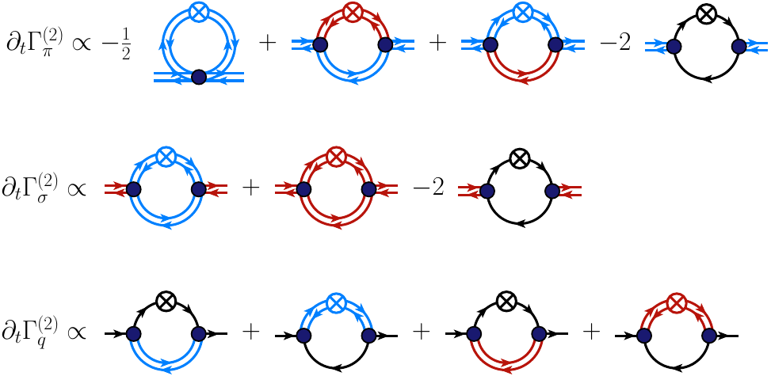

# User guide

This guide builds the two-point flow figure of the quark–meson model step by step. It only uses
the mouse and the palette; no LaTeX code is needed except for the text terms.

The finished file is available in the app under **Library… → Examples**, and also as
[`examples/2pt_flow.frg.json`](../examples/2pt_flow.frg.json). The
[PDF](../examples/2pt_flow.pdf) is rendered from the TikZ export.

## 1. Place the diagrams

1. Pick **Pion** in *Lines*, then **Tadpole** in *Diagrams*, and click on the canvas.
2. Pick **Polarisation / self-energy** and click three more times to the right. Each click
   places a complete bubble: vertices, legs, and ⊗ on the upper line. All of them have the same
   size, taken from the style sheet.
3. A placed diagram is a **group**: one click selects it and it moves as one unit, so its shape
   can't be deformed by accident.

## 2. Swap lines and vertices

- **Lines:** choose the **Line** tool (`L`), pick **Sigma** in the palette, and click the upper
  line of the second bubble. That line is repainted. Do the same for the lower line of the third
  bubble, and paint the fourth bubble's loop with **Quark**.
- **Regulator:** in Select mode (`V`), drag the ⊗ onto another line to move it.
- **Vertices:** the **Vertex** tool (`P`) with a vertex type picked in the palette changes the
  vertex you click.
- **Many lines at once:** select a whole diagram and click a field in the palette.

## 3. Add the text terms

The **Text** tool (`T`) places TeX terms:
- click empty space for a free term such as `\partial_t\Gamma^{(2)}_\pi \propto -\frac12`,
  `+` or `-2`;
- click a line or a vertex for a label that moves with it. It defaults to the field's symbol.

Type the TeX in the inspector and press Enter to finish.

## 4. Arrange the row

Select the terms and diagrams of one row (rubber-band or `Ctrl+A`) and press `A` (**Arrange
row**). They are placed left to right with equal gaps, on the centre line of the leftmost item.
For several rows, use **Arrange → ⇤ left** in the inspector to align their left-hand sides.

Shortcut for sums: select one diagram and click **⊗ on each line → sum**. This creates the copies
with ⊗ on each internal line, joined by `+`.

## 5. Export

- **Export PDF:** a vector PDF with TeX fonts, cropped tightly. Include it with
  `\includegraphics`.
- **TikZ / Copy TikZ:** the same drawing as a `tikzpicture`. Labels are typeset by your paper's
  LaTeX.
- **SVG:** for slides and the web.

Every export contains the editable source, so **Open…** on the PDF, SVG or `.tex` file brings the
diagram back. **Save** writes the `.frg.json` source.

## Style and types

- **Style sheet:** with nothing selected, the inspector shows the style sheet: line width,
  double-line spacing, vertex and ⊗ sizes, and label sizes. Presets switch the whole document
  to *Journal (black & white)*, *Grayscale* or *Talk (bold)*.
- **Lines & vertices…** edits the types themselves:
  - line style, arrows, colour and parameters of each field;
  - shape, size, fill, outline and inner text of each vertex type.

  New types are added from the same dialog.
- **Library…** holds the group library and your own templates. **Save as template** is in the
  inspector when a diagram is selected. Share templates with *Export my library*.

## More tools

- **Flow…** (toolbar): the complete one-loop flow of an n-point function. Tick the line types
  that make up the field content (mark charged fields and fermions), add the external legs with
  the buttons below and, optionally, restrict the vertices. **Regulator** chooses ⊗ on each line
  (one term per regulator position) or ∂̃ₜ in front of diagrams without regulator. FunKit (by F. R. Sattler) computes
  every diagram with its prefactor in the browser, and the equation is added below your drawing,
  ready to edit.

- **Box** (`B`): shaded boxes or ellipses behind the diagram. The inspector sets fill, opacity,
  outline and corner radius.
- **Momentum arrows:** select a single line (double-click inside a group) and tick *Momentum
  arrow*.
- **Arrange panel** (select several items):
  - align edges or centres, and distribute evenly;
  - rotate by 15° or 90° (`[` / `]`, Shift for 90°) and mirror.
- **Snapping:** everything snaps to the grid, arcs to straight lines and semicircles, and loops
  to the style's loop radius. Hold `Alt` to place freely.
